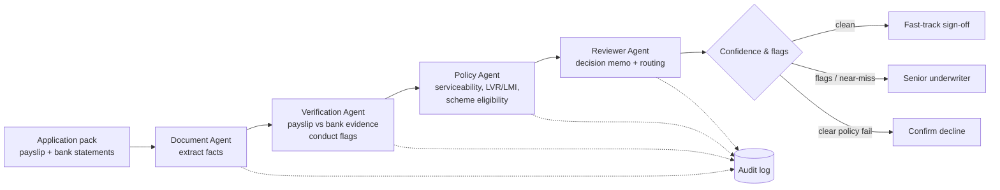

# Home Loan Triage Agent

> A multi-agent system that turns a raw mortgage application pack into a **decision-ready file for a human underwriter** — with cited evidence, risk flags and a full audit trail.

   

---

## 1. Problem

Home loan underwriting is slow and repetitive. For every application an underwriter must:

- read payslips and bank statements,
- reconcile stated income against what actually lands in the account,
- check serviceability, LVR/LMI and government-scheme eligibility against policy,
- write up the reasoning so the decision can be audited later.

Most of that effort is on **clean applications that will be approved anyway**, which delays the messy ones that need real judgement.

## 2. Who it is for

| User | Job to be done | Pain today |
|---|---|---|
| **Underwriter** | Make a fast, defensible credit decision | Manual document reading and cross-checking |
| **Credit risk / compliance** | Prove every decision followed policy | Reasoning is scattered across notes and emails |
| **Applicant** | Get a timely answer | Queue time dominated by routine files |

## 3. Solution

Four specialised agents run in sequence. Every step writes to an append-only audit log, and **the system only ever recommends. A human signs off.**



| Agent | Responsibility | Output |
|---|---|---|
| **Document** | Pull employer, salary and transactions out of the pack | Structured facts |
| **Verification** | Cross-check stated vs bank-evidenced income; scan for conduct red flags | Verified income, severity-ranked flags |
| **Policy** | Apply serviceability (stressed rate), LVR/LMI and First Home Guarantee rules, each cited to a policy reference | Pass/fail findings with citations |
| **Reviewer** | Combine everything into a memo and choose the queue | Recommendation, confidence, routing |

## 4. Design principles (the PM decisions)

1. **Recommend, never decide.** Every output ends with a human underwriter. The agent removes reading time, not accountability.
2. **Verify income against evidence, not claims.** Serviceability runs on *bank-evidenced* income, so a payslip that overstates income cannot inflate capacity.
3. **Escalate uncertainty instead of auto-declining.** A small shortfall goes to a person (see the near-miss band below), not to an automatic decline.
4. **Every claim is cited.** Each finding carries a policy reference, so a reviewer can trace it back.
5. **Auditability is a feature.** Each agent action is logged (`audit_log.jsonl`) with timestamp, agent and detail.

### A decision I changed after testing

My first run auto-declined an applicant at 90% confidence for a **$47/month** shortfall. That is a bad outcome: a tiny gap on stressed assumptions should not produce a confident decline. I added a **near-miss band** (`near_miss_band`, default $250/month). Shortfalls inside it are *referred* to an underwriter. Only clear failures are recommended for decline.

## 5. Demo results

Four synthetic applicants, run end to end (see [`sample_output/`](sample_output/)):

| Application | What the agents found | Recommendation | Routed to |
|---|---|---|---|
| APP-1003 | Income matches bank; eligible for First Home Guarantee (LMI waived) | **Approve** | Fast-track sign-off |
| APP-1002 | Payslip net $10,200/mo vs bank $8,900/mo (−12.8%); $1,950 gambling transactions over 3 months | **Refer** | Senior underwriter |
| APP-1001 | $47/mo short on serviceability at the stressed rate | **Refer** (near-miss) | Senior underwriter |
| APP-1004 | $3,513/mo short; 90% LVR | **Decline** recommended | Underwriter confirms |

Sample artefacts: [decision memo](sample_output/APP-1002_memo.md) · [audit log](sample_output/audit_log.jsonl)

## 6. Success metrics (proposed, not yet measured)

These are the metrics I would use to judge a production version. **None are measured in this proof of concept**; they are hypotheses to validate with a labelled evaluation set.

| Metric | Why it matters | Target to test |
|---|---|---|
| Underwriter handling time per file | Core value: time saved | Meaningful reduction vs baseline |
| Agreement with human decision | Quality of recommendations | High on clean files |
| False-approve rate | Risk: the costly error | Near zero; tuned conservatively |
| Escalation rate | Is the agent too cautious or too bold? | Stable, explainable |
| Flag precision | Are flags useful or noisy? | High enough to be trusted |

## 7. Risks and guardrails

| Risk | Mitigation in this design |
|---|---|
| Wrong auto-approval | Never auto-final; human sign-off on every file |
| Hallucinated policy | Rules are explicit and cited; a production version would retrieve from the actual policy document |
| Bias / fairness | Decisions use financial evidence only; a production version needs fairness testing before use |
| Privacy | Synthetic data only; a real deployment needs PII controls and data residency review |
| Silent drift | Audit log supports after-the-fact review; add an eval set to detect regressions |

## 8. Roadmap

- [x] **v0:** Rule-based four-agent pipeline, audit log, decision memos, tests
- [ ] **v1:** LLM-driven Document and Verification agents (Claude Agent SDK or LangGraph) reading real PDFs
- [ ] **v1:** Policy agent with retrieval over a policy document, with citations
- [ ] **v2:** Evaluation harness with 30–50 labelled applications (accuracy, cost, latency, failure cases)
- [ ] **v2:** Underwriter review UI with approve / override and feedback capture

## 9. Run it

Requires Python 3.7+ and nothing else (standard library only).

```bash
git clone https://github.com/Neeraj-Mh/Home_loan_triaging.git
cd Home_loan_triaging
python3 triage_agent.py          # runs the demo, writes ./out/
python3 -m unittest discover -s tests -v   # runs the tests
```

To experiment, edit the `POLICY` block at the top of `triage_agent.py` or add applicants to `APPLICATIONS`.

## 10. Swapping in an LLM

Each agent exposes a single `run(...)` method. To make an agent LLM-driven, replace its body with a model call that returns the same structure. The orchestration (`run_pipeline`), audit logging and routing stay unchanged.

## 11. Important notes

- **Synthetic data only.** All applicants, documents and transactions are invented.
- **Illustrative policy.** Thresholds (3% buffer, scheme caps, expense floor) are placeholders. They are **not** any bank's or government's real policy and must not be used for lending decisions.
- **Personal project.** This is an independent portfolio project. It contains no proprietary systems, data or policy from any employer.
- **Proof of concept.** Not production software and not financial advice.

## License

MIT. See [LICENSE](LICENSE).
